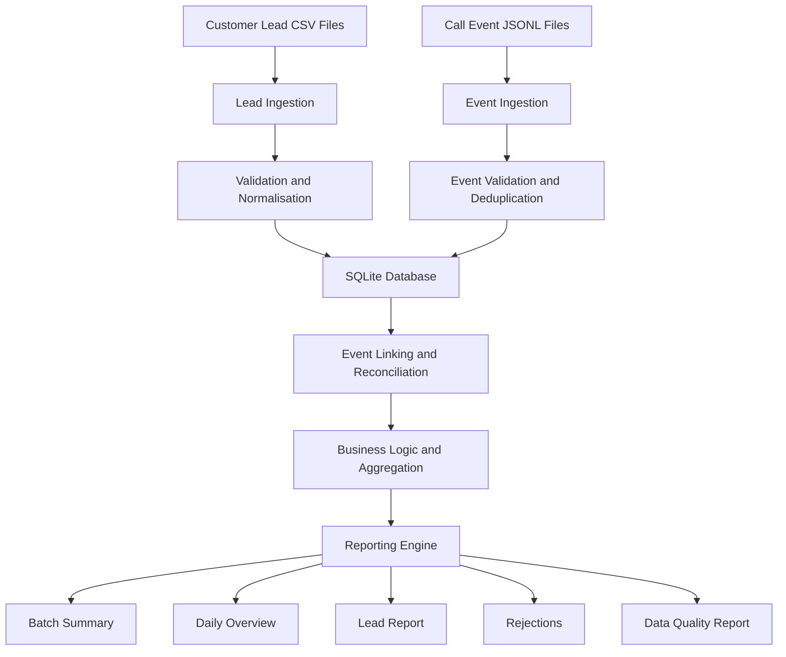

# Interaction Ledger & Reporting Pipeline

**A Python-based data engineering project for processing customer leads and call interaction records.**


## About the Project

This project started with a practical data engineering problem: how do you maintain accurate customer records and interaction histories when the information comes from different sources and is not always clean?

Consider an insurance company that needs to manage customers whose motor insurance policies are approaching expiration. Customer information may arrive in CSV files, while an existing calling platform generates separate records describing the interactions with those customers.

These datasets can contain duplicate customers, invalid phone numbers, missing values, inconsistent dates and repeated call events. Some interaction events may also arrive before the corresponding customer record is available.

Processing everything manually makes it difficult to maintain accurate records and generate reliable reports.

I built this **Interaction Ledger & Reporting Pipeline** to handle that process. It takes the supplied customer and interaction data, validates and normalises it, stores the information securely in SQLite and generates reports that can be used to understand customer activity.

The main focus of the project is data correctness, secure storage, consistent processing and reliable reporting.

## What Does It Actually Do?

The application works with two types of input data.

**Customer lead data (CSV)**

This contains information such as:
- Customer contact details.
- Policy numbers.
- Policy expiry dates.
- Premium amounts.
- Preferred communication languages.

**Customer interaction data (JSONL)**

This contains events produced by an existing calling system, including:
- Call initiated.
- Call connected.
- Call completed.
- Customer interested.
- Customer not interested.
- Callback requested.
- Wrong number.
- Do not disturb (DND).

The pipeline processes these inputs separately and connects the interaction history to the corresponding customer records.

## How the Pipeline Works

I divided the implementation into smaller modules so that each stage has a clear responsibility. This also makes individual components easier to test and debug.



### Processing flow

1. Read customer CSV files and call-event JSONL files.
2. Validate incoming records against the supplied schemas.
3. Normalise phone numbers, dates, decimal values and headers.
4. Identify invalid records and record their rejection reasons.
5. Detect and merge duplicate customer records.
6. Encrypt sensitive customer information before storage.
7. Match interaction events with their corresponding leads.
8. Retain unmatched events and retry linking when later lead data arrives.
9. Calculate lead and call-level information.
10. Generate the five required reports.

## Project Structure

The code is organised by functionality rather than keeping all processing logic in a single Python file.

| File | Responsibility |
|---|---|
| `main.py` | Entry point for ingestion and report commands |
| `database.py` | SQLite database creation and connection management |
| `normalizers.py` | Phone, date, decimal, enum and header normalisation |
| `encryption.py` | Sensitive-data encryption and HMAC generation |
| `lead_ingestion.py` | Customer lead validation, ingestion and duplicate merging |
| `event_ingestion.py` | Call-event ingestion, deduplication and orphan linking |
| `reporting.py` | Business calculations and report generation |
| `utils.py` | Shared helper functions |

## Key Implementation Details

### 1. Schema-based data validation

Incoming customer records are checked against the schemas provided with the assignment.

The validation process handles required fields, optional fields, alternate CSV headers and different data formats.

Phone numbers, dates, decimal values and enum fields are normalised before they are stored.

When a record is invalid, the pipeline records a rejection reason rather than silently ignoring it. This makes it easier to understand what went wrong with the incoming data.

### 2. Duplicate customer handling

A customer may appear more than once in the supplied lead files.

Instead of inserting another record every time, the system uses workflow-specific phone matching to identify existing customers.

Duplicate information is merged into the existing record according to the assignment's rules. The original batch association is preserved, and available non-null values are applied without unnecessarily replacing existing information with missing values.

### 3. Protecting customer information

Customer phone numbers and other sensitive fields should not be stored in readable form.

For this, I implemented two separate mechanisms:

**Fernet encryption**

Sensitive information is encrypted before being stored in SQLite.

**HMAC-SHA256**

A separate keyed HMAC is used for deterministic phone-number matching. This allows the system to identify the same customer without needing to store the original phone number as plaintext.

The encryption and HMAC keys are configured separately through environment variables.

Reports use masked phone numbers, and local secrets are excluded from Git.

### 4. Interaction event management

The event ingestion module maintains an append-only history of customer interactions.

One important decision was to preserve original events rather than overwrite them whenever a new interaction or correction arrives.

The implementation handles:

- Duplicate event IDs.
- Events without a matching lead.
- Later orphan-event reconciliation.
- Call ID-based disposition overrides.
- Unknown disposition codes.
- Timestamp normalisation.

An orphan event is not immediately discarded just because its corresponding customer record is unavailable. It is retained and can be matched when the relevant lead data becomes available later.

Disposition overrides are used when a previous call outcome needs correction. The original event remains in the ledger, while the effective disposition is derived from the event history.

### 5. Repeatable and reliable ingestion

The pipeline also needs to handle repeated execution safely.

For example, running the same ingestion command twice should not create duplicate customer records or interaction events.

I used persistent processing metadata, unique identifiers, database constraints and transactions to support idempotent ingestion.

Each data drop is committed atomically so that a failed ingestion can be retried without retaining partial database writes.

## Database Design

I chose SQLite because this assignment requires a local, persistent relational database and does not require a separately managed database server.

The database separates the different types of information into dedicated tables.

| Table | Purpose |
|---|---|
| `leads` | Validated customer information |
| `events` | Original interaction event records |
| `event_links` | Relationships between leads and events |
| `batches` | Incoming customer batch tracking |
| `rejections` | Rejected records and their reasons |
| `ingestion_drops` | Tracking previously processed data drops |
| `dispositions` | Supported disposition definitions |
| `pipeline_metrics` | Cumulative processing metrics |

Primary keys, unique constraints, indexes and database transactions help maintain consistency between these records.

## Reports Generated

The pipeline generates five required reports inside `solution/reports/`.

### 1. `batch_summary.csv`

This report gives a batch-level view of the customer records processed.

It includes the total number of leads and their classification into the required status categories.

It helps understand how each incoming batch was processed.

### 2. `daily_overview.csv`

This report summarises daily calling activity.

It includes:
- Total calls.
- Connected calls.
- Connectivity rate.
- Successful lead count.

The connectivity rate is calculated using connected calls divided by total calls.

### 3. `lead_report.csv`

This provides an individual view of each customer lead.

It includes the workflow ID, external reference, batch ID, masked phone number, current lead status, total calls, connected calls, last call timestamp, current effective disposition and ever-success indicator.

### 4. `rejections.csv`

This report records invalid customer rows and explains why each one was rejected.

It is useful for identifying recurring problems in incoming datasets.

### 5. `data_quality.json`

This provides an overall view of data quality.

It contains metrics such as:
- Total lead rows.
- Rejected lead rows.
- Duplicate lead rows merged.
- Field warnings.
- Total event lines.
- Malformed events.
- Duplicate events dropped.
- Orphan events.
- Unknown disposition events.
- Rejections grouped by reason.

## Technology Stack

| Technology | How it is used |
|---|---|
| Python | Main programming language |
| SQLite | Persistent relational data storage |
| CSV | Customer lead input and report output |
| JSON / JSONL | Schemas and interaction event data |
| Cryptography / Fernet | Sensitive-data encryption |
| HMAC-SHA256 | Secure deterministic matching |
| Python-dotenv | Environment-based configuration |
| Pytest | Automated testing |
| Git and GitHub | Version control |

## Installation and Setup

### Prerequisites

- Python 3.10 or later.
- Git.
- Visual Studio Code or another Python development environment.

### Clone the repository

```bash
git clone https://github.com/Harsh28-HB/interaction-ledger-reporting-pipeline.git
cd interaction-ledger-reporting-pipeline
```

### Create a virtual environment

For Windows PowerShell:

```powershell
python -m venv .venv
.\.venv\Scripts\Activate.ps1
```

### Install dependencies

```powershell
python -m pip install -r requirements.txt
```

### Configure encryption keys

Create a local `.env` file inside the `solution` directory.

The following command generates separate encryption and HMAC keys:

```powershell
python -c "from pathlib import Path; from cryptography.fernet import Fernet; import secrets; Path('solution/.env').write_text('LEDGER_FERNET_KEY=' + Fernet.generate_key().decode() + '\nLEDGER_HMAC_KEY=' + secrets.token_hex(32) + '\n', encoding='utf-8')"
```

Keep these keys stable between runs. Generating new keys for an existing encrypted database can make previously stored values inaccessible.

Never upload `.env` or the actual encryption keys to GitHub.

## Generating Sample Data

The supplied generator can be used to create the small sample dataset.

Run this command from the repository root:

```powershell
python assignment-a-data\tools\generate_data.py --seed 42 --scale small --out data
```

This generates two data drops under the `data/` directory.

Use a different output directory if you need to preserve previously generated data.

## Running the Pipeline

Move into the solution directory:

```powershell
cd solution
```

To see the available commands:

```powershell
python -m src.main --help
```

**Ingest the first data drop:**

```powershell
python -m src.main ingest ..\data\drop_1
```

**Ingest the second data drop:**

```powershell
python -m src.main ingest ..\data\drop_2
```

**Generate all five reports:**

```powershell
python -m src.main report --out reports
```

The generated files will be available under:

```text
solution/reports/
```

The local SQLite ledger is stored at:

```text
solution/interaction_ledger.db
```

## Automated Testing

I used pytest to verify the individual components and the overall processing behaviour.

Run all tests from inside `solution`:

```powershell
python -m pytest -v
```

For a shorter summary:

```powershell
python -m pytest -q
```

To check Python compilation:

```powershell
python -m compileall -q src tests
```

The recorded test suite contains 61 passing tests. The tests cover normalisation, validation, lead processing, event processing, database operations and reporting behaviour.

The tests use temporary databases and test-only encryption keys so that they do not modify the actual local ledger.

## Validation Results

An additional small-data validation run was performed using seed `2026`, separate from the original seed `42` dataset.

The recorded results were:

| Metric | Result |
|---|---:|
| Total lead rows | 2,070 |
| Rejected lead rows | 88 |
| Duplicate lead rows merged | 70 |
| Field warnings | 127 |
| Stored leads | 1,912 |
| Total event lines | 9,027 |
| Malformed events | 8 |
| Duplicate event deliveries | 271 |
| Unknown dispositions | 19 |
| Stored events | 8,748 |
| Orphan events remaining | 422 |

The following additional checks were reported as successful:

- Re-ingesting both drops did not change the database contents.
- Generated report files remained byte-identical after repeat ingestion.
- All five reports decoded as UTF-8 without a byte-order mark.
- Stored database text and generated reports were checked for plaintext lead phone numbers.
- SQLite integrity checks passed on the existing Assignment A database.

These are results from the recorded validation run and are not intended to imply that every possible input dataset will produce the same counts.

## Limitations and Possible Improvements

This implementation is designed around the local SQLite processing environment supplied for the assignment.

With additional development time, I would focus on:

1. Testing the pipeline against the large-data dataset and measuring query performance.
2. Adding explicit schema versioning and migration support.
3. Improving observability through structured logging.
4. Documenting encryption-key rotation and database backup procedures.
5. Profiling report aggregation for larger event volumes.
6. Adding more automated tests for unusual event ordering and reconciliation scenarios.

Events that still have no matching customer record are retained as or